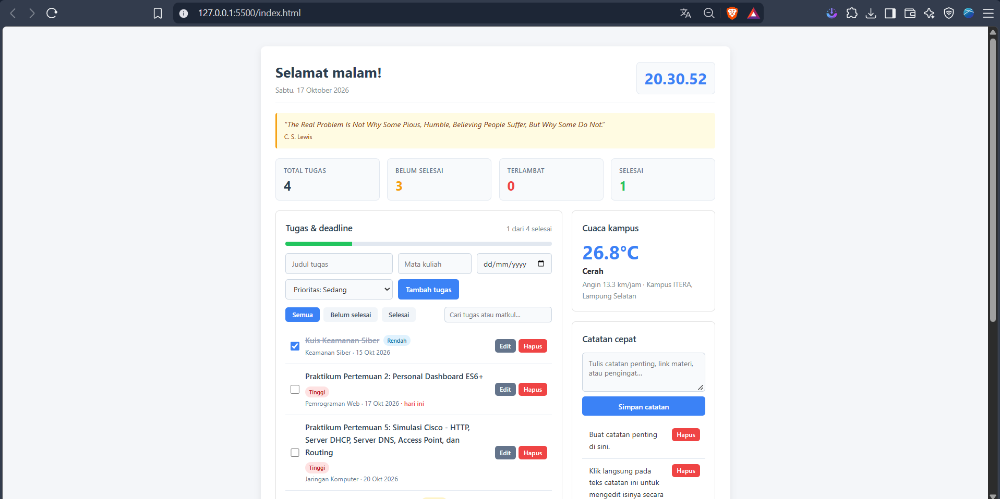

# Personal Dashboard

Dashboard pribadi untuk mahasiswa. Satu halaman untuk mengelola tugas beserta tingkat prioritas dan tenggat waktu, mencatat jadwal kuliah, menyimpan catatan cepat, melihat cuaca kampus ITERA (Lampung Selatan), dan membaca kutipan motivasi harian.

Tugas Praktikum Pertemuan 2 — JavaScript Next Gen (ES6+).

## Fitur

| Fitur | Keterangan |
| :-- | :-- |
| Kartu ringkasan statistik | Menampilkan jumlah Total Tugas, Belum Selesai, Terlambat, dan Selesai secara otomatis menggunakan `.reduce()`. |
| Daftar tugas & prioritas | Tambah, edit, hapus, tandai selesai, dan beri label prioritas (Tinggi, Sedang, Rendah). Diurutkan berdasarkan deadline. |
| Penanda deadline | Tugas yang lewat tenggat ditandai "terlambat", yang jatuh tempo hari ini ditandai "hari ini". |
| Filter & pencarian | Filter berdasarkan status (Semua, Belum selesai, Selesai) dan pencarian *real-time* berdasarkan judul/mata kuliah. |
| Jadwal kuliah | Tambah dan hapus jadwal mata kuliah lengkap dengan hari, jam, dan ruangan kelas. |
| Catatan cepat | Tambah, hapus, dan edit langsung (*inline*) dengan mengklik teks catatan. |
| Cuaca kampus | Suhu, kondisi cuaca, dan kecepatan angin real-time dari Open-Meteo API. |
| Kutipan harian | Kutipan motivasi acak dari DummyJSON API. |
| Jam dan sapaan | Jam digital *real-time* dan sapaan dinamis sesuai waktu (pagi, siang, sore, malam). |

Semua data tugas, jadwal kuliah, dan catatan disimpan di `localStorage` dengan kunci `meja-kuliah-v1` (dilengkapi data contoh awal otomatis saat pertama kali dibuka).

## Struktur
personal-dashboard/
├── index.html
├── style.css
├── script.js
├── README.md
└── screenshot/
└── dashboard.png

## Cara menjalankan

1. Buka folder proyek di VS Code.
2. Klik kanan `index.html`, pilih **Open with Live Server**.
3. Koneksi internet dibutuhkan untuk memuat cuaca dan kutipan harian. Fitur tugas, jadwal kuliah, dan catatan tetap berfungsi penuh tanpa internet.
4. Jika sebelumnya Anda sudah pernah membuka halaman ini, klik tombol **"Muat ulang data contoh"** di bagian paling bawah (*footer*) untuk menampilkan data contoh awal.

## Screenshot

## Fitur ES6+ yang diimplementasikan

Semua nomor baris di bawah ini merujuk langsung ke file `script.js`.

| Fitur ES6+ | Baris | Keterangan |
| :-- | :-- | :-- |
| `const` | 4–7, 15–19, 64, 187–246, 368 | Konstanta konfigurasi, fungsi helper, data awal, dan fungsi render. |
| `let` | 260 | Variabel `part` yang nilainya berubah mengikuti jam pada fungsi sapaan `renderHeader()`. |
| Arrow function | 15–19, 64, 189, 199, 226, 243, 257, 368 | Fungsi `$`, `makeId`, `esc`, `formatDate`, `offsetDate`, `getSeedData`, `render*`, `loadExternal`, serta callback pada array methods dan event listener. |
| Template literals | 172, 179, 202–220, 230–238, 246–250, 381–384 | Rendering elemen HTML dinamis untuk daftar tugas, jadwal, catatan, cuaca, dan URL endpoint API. |
| Async/await | 171, 178, 368 | Mengambil data dari API publik secara asinkron pada `fetchQuote()`, `fetchWeather()`, dan `loadExternal()`. |
| Promise | 369 | Menggunakan `Promise.allSettled()` agar pemanggilan API kutipan dan cuaca berjalan paralel tanpa saling menggagalkan. |
| Class | 26, 48, 55, 86 | Implementasi OOP dengan `TaskItem`, `NoteItem`, `ScheduleItem`, dan `DashboardApp`. |
| Getter | 36, 42, 126, 136 | Getter `daysLeft` & `isOverdue` pada `TaskItem`, serta `visibleTasks` & `stats` pada `DashboardApp`. |
| Destructuring | 27, 49, 56, 95, 108, 132, 174, 182, 190, 202, 297, 311 | Membongkar parameter konstruktor, isi `localStorage`, objek state, properti event (`{ target }`), dan respons JSON API. |
| Default parameter | 27, 56, 95 | Nilai bawaan pada konstruktor `id = makeId()`, `priority = "medium"`, `done = false`, `day = "Senin"`, dan `tasks = []`. |
| Spread operator | 45, 96, 118, 121, 148, 323, 328 | Memperbarui state dan menyalin objek secara *immutable* (`{ ...this.state }`, `[new TaskItem(data), ...this.state.tasks]`). |
| Optional chaining & `??` | 95, 183, 209, 299 | Penanganan nilai kosong dengan Nullish Coalescing (`??`) dan pembacaan DOM aman dengan `?.`. |
| Modern Array Methods | 98–100, 121, 125, 130–133, 137, 301 | Penggunaan `.map()`, `.filter()`, `.reduce()`, `.find()`, dan `.sort()` untuk pengolahan state deklaratif. |

## Arsitektur

- `TaskItem` memodelkan satu entitas tugas beserta tingkat prioritas dan kalkulasi sisa hari tenggat waktu. Metode `with()` mengembalikan instansiasi baru agar state bersifat *immutable*.
- `ScheduleItem` memodelkan jadwal perkuliahan mingguan mahasiswa.
- `NoteItem` memodelkan catatan singkat.
- `DashboardApp` bertindak sebagai pengelola utama aplikasi yang mengatur state, sinkronisasi `localStorage`, perhitungan statistik dengan `.reduce()`, dan komunikasi `fetch()` ke API eksternal.
- Fungsi `render*` memperbarui DOM secara reaktif menggunakan *template literals* yang telah disanitasi dengan helper `esc()` untuk mencegah injeksi HTML.

## Sumber API

- Cuaca: `https://api.open-meteo.com/v1/forecast?latitude=-5.36&longitude=105.31&current_weather=true`
- Kutipan: `https://dummyjson.com/quotes/random`
