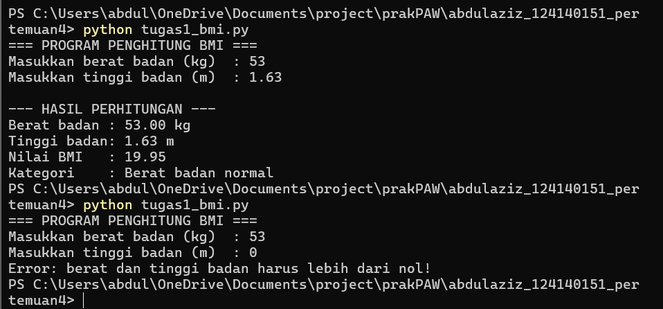
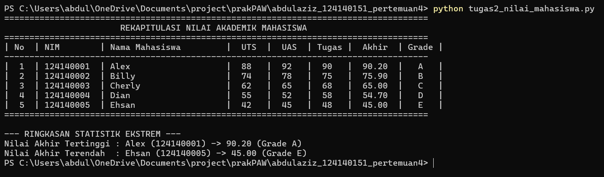
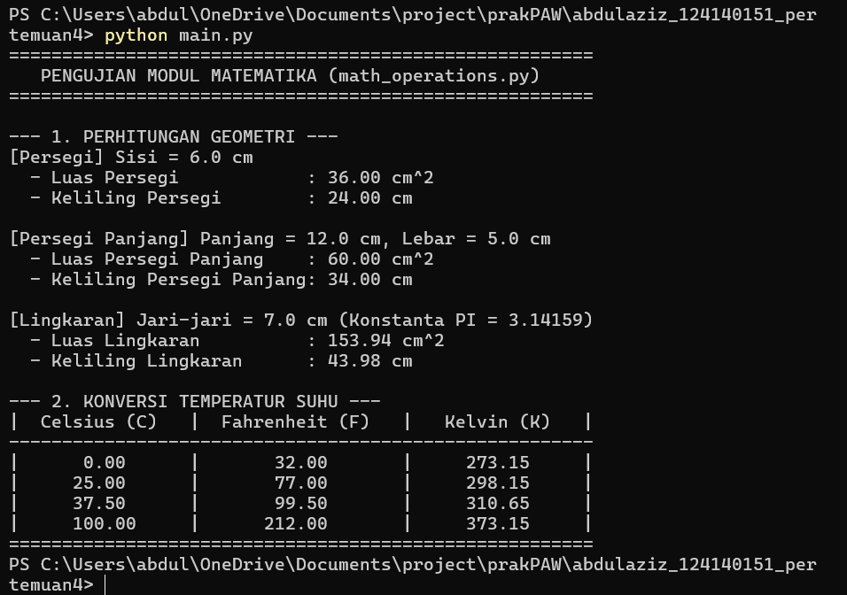

# Tugas Praktikum Pemrograman Web - Pertemuan 4 (Python Dasar)
**Mata Kuliah:** Praktikum Pengembangan Aplikasi Web (PAW)  
**Topik:** Python Dasar

## Identitas Mahasiswa
- **Nama** : Abdul Aziz
- **NIM** : 124140151
- **Kelas Praktikum** : RB

---

## Struktur Direktori
```text
abdulaziz_124140151_pertemuan4/
├── README.md
├── tugas1_bmi.py
├── tugas2_nilai_mahasiswa.py
├── math_operations.py
├── main.py
└── output/
    ├──image.png
    ├──image1.png
    └──image2.png
```

---

## Deskripsi Alur Kerja Program

### 1. Program Penghitung BMI (`tugas1_bmi.py`)
Program ini menghitung indeks massa tubuh (*Body Mass Index*) berdasarkan input berat badan (kg) dan tinggi badan (m) dari pengguna.
- **`hitung_bmi(berat, tinggi)`**: Menghitung nilai BMI menggunakan rumus `BMI = berat / (tinggi ** 2)`.
- **`tentukan_kategori(bmi)`**: Mengklasifikasikan hasil BMI menggunakan percabangan `if-elif-else` ke dalam 4 kategori:
  - `BMI < 18.5`: Berat badan kurang
  - `18.5 <= BMI < 25`: Berat badan normal
  - `25 <= BMI < 30`: Berat badan berlebih
  - `BMI >= 30`: Obesitas
- **`main()`**: Menerima input pengguna, menolak berat atau tinggi yang bernilai nol maupun negatif, lalu menampilkan hasil BMI dengan format 2 angka di belakang koma (`f-string`). Kategori pertama ditampilkan sebagai **Kekurangan berat badan**.

### 2. Program Pengelolaan Data Nilai Mahasiswa (`tugas2_nilai_mahasiswa.py`)
Program ini mengelola data 5 mahasiswa (Alex, Billy, Cherly, Dian, dan Ehsan) yang disimpan dalam struktur `list` of `dictionary` dengan kunci `nama`, `nim`, `nilai_uts`, `nilai_uas`, dan `nilai_tugas`.
- **`hitung_nilai_akhir(uts, uas, tugas)`**: Menghitung nilai akhir berdasarkan bobot `30% UTS + 40% UAS + 30% Tugas`.
- **`tentukan_grade(nilai_akhir)`**: Menentukan huruf mutu dengan ambang `A >= 80`, `B >= 70`, `C >= 60`, `D >= 50`, dan `E < 50`.
- **`proses_data_mahasiswa(daftar_mahasiswa)`**: Menambahkan nilai akhir dan grade ke setiap dictionary mahasiswa.
- **`tampilkan_tabel_mahasiswa(daftar_mahasiswa)`**: Menampilkan seluruh data mahasiswa secara lengkap dalam bentuk tabel yang rapi di terminal.
- **`cari_nilai_ekstrem(daftar_mahasiswa)`**: Mencari mahasiswa dengan nilai akhir tertinggi dan terendah menggunakan fungsi `max()` dan `min()` berbasis `lambda`.

### 3. Modul Matematika & Program Utama (`math_operations.py` & `main.py`)
- **`math_operations.py`**: Modul matematika kustom yang memuat:
  - Konstanta `PI = 3.14159`
  - Fungsi luas dan keliling **Persegi** (`luas_persegi`, `keliling_persegi`)
  - Fungsi luas dan keliling **Persegi Panjang** (`luas_persegi_panjang`, `keliling_persegi_panjang`)
  - Fungsi luas dan keliling **Lingkaran** (`luas_lingkaran`, `keliling_lingkaran`)
  - Fungsi konversi suhu **Celsius ke Fahrenheit** (`celsius_ke_fahrenheit`) dan **Celsius ke Kelvin** (`celsius_ke_kelvin`)
- **`main.py`**: Program utama yang mendemonstrasikan berbagai cara mengimpor modul (`import math_operations`, `import math_operations as mo`, dan `from math_operations import ...`) serta menguji fungsi geometri dan konversi suhu.
- **Eksekusi langsung `math_operations.py`**: Menampilkan contoh pengujian singkat konstanta `PI`, luas persegi, dan konversi Celsius ke Fahrenheit.

---

## Cara Menjalankan Program di Terminal

Buka terminal di VS Code dan pastikan berada di dalam direktori proyek:

1. **Menjalankan Soal 1 (Kalkulator BMI):**
   ```bash
   python tugas1_bmi.py
   ```

2. **Menjalankan Soal 2 (Pengelolaan Nilai Mahasiswa):**
   ```bash
   python tugas2_nilai_mahasiswa.py
   ```

3. **Menjalankan Soal 3 (Modul Matematika):**
   ```bash
   python main.py
   ```

---

## Contoh Hasil Eksekusi

### 1. `tugas1_bmi.py`



### 2. `tugas2_nilai_mahasiswa.py`



### 3. `main.py`


