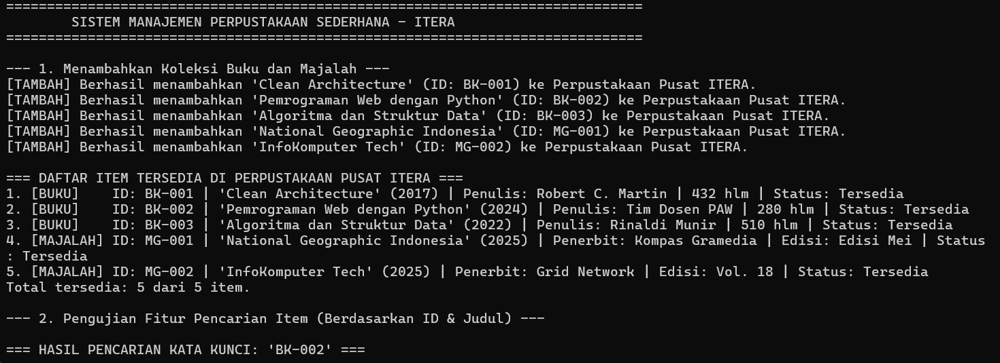
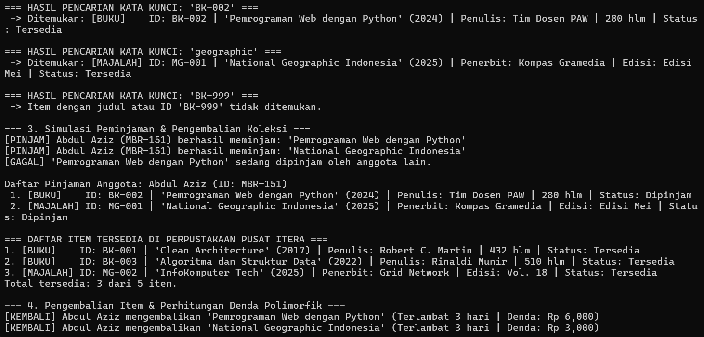
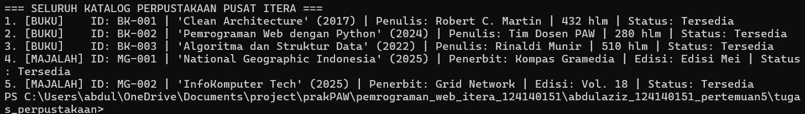

# Tugas Praktikum Pemrograman Web - Pertemuan 5 (Python OOP)
**Mata Kuliah:** Praktikum Pengembangan Aplikasi Web (PAW)  
**Topik:** Pemrograman Berorientasi Objek dengan Python (Python OOP)

## Identitas Mahasiswa
- **Nama** : Abdul Aziz
- **NIM** : 124140151
- **Kelas Praktikum** : RB

---

## Struktur Direktori
```text
abdulaziz_124140151_pertemuan5/
├── latihan/
│   ├── 01_everything_is_object.py
│   ├── 01_procedural_vs_oop.py
│   ├── 02_class_object.py
│   ├── 03_inheritance.py
│   ├── 04_encapsulation.py
│   ├── 05_polymorphism.py
│   ├── 06_abstract_class.py
│   ├── latihan_kasir.py
│   ├── latihan_buku.py
│   ├── latihan_truk.py
│   ├── latihan_karyawan.py
│   ├── latihan_notifikasi.py
│   └── latihan_storage.py
├── tugas_perpustakaan/
│   ├── library_item.py
│   ├── member.py
│   ├── library.py
│   └── main.py
├── README.md
└── .gitignore
```

---

## Deskripsi Program & Penerapan 4 Pilar OOP

Program utama pada direktori `tugas_perpustakaan/` merupakan **Sistem Manajemen Perpustakaan Sederhana** yang dirancang menggunakan 4 pilar utama *Object-Oriented Programming* (OOP) di Python:

### 1. Abstraction (`library_item.py`)
- Menggunakan modul `abc` (`ABC` dan `@abstractmethod`) pada class induk `LibraryItem(ABC)`.
- Mendefinisikan kontrak desain melalui dua *abstract method* yaitu `get_detail()` dan `hitung_denda(hari_terlambat)` yang wajib diimplementasikan oleh setiap *subclass*.

### 2. Inheritance (`library_item.py`)
- Subclass **`Book`** dan **`Magazine`** mewarisi atribut dasar (`_item_id`, `_judul`, `_tahun_terbit`, dan status pinjam) dari parent class `LibraryItem` menggunakan `super().__init__(...)`.
- **`Book`** menambahkan atribut spesifik `penulis` dan `jumlah_halaman`.
- **`Magazine`** menambahkan atribut spesifik `penerbit` dan `edisi`.

### 3. Encapsulation (`library_item.py`, `member.py`, `library.py`)
- Menggunakan *protected attributes* (`_item_id`, `_judul`, `_tahun_terbit`) pada `LibraryItem` agar hanya diakses oleh class dan turunannya.
- Menggunakan *private attributes* (Name Mangling `__`) untuk melindungi data penting dari modifikasi langsung:
  - `__is_dipinjam` pada `LibraryItem` (diakses dan divalidasi melalui decorator `@property` dan `@is_dipinjam.setter`).
  - `__koleksi` pada `Library` (dilindungi agar penambahan item hanya bisa melalui method `tambah_item()`).
  - `__item_dipinjam` pada `Member` (dilindungi agar peminjaman dan pengembalian tercatat valid melalui method `pinjam()` dan `kembalikan()`).

### 4. Polymorphism (`library_item.py`, `library.py`, `member.py`)
- Method `get_detail()` di-*override* oleh `Book` dan `Magazine` dengan format tampilan masing-masing, lalu dipanggil secara seragam saat `Library.tampilkan_item_tersedia()` dan `Library.cari_item()` melakukan iterasi koleksi.
- Method `hitung_denda(hari_terlambat)` di-*override* dengan tarif berbeda (Buku: Rp 2.000/hari, Majalah: Rp 1.000/hari) dan dipanggil secara polimorfik saat anggota mengembalikan item.

---

## Panduan Menjalankan Program

Buka terminal di VS Code dan arahkan ke folder `abdulaziz_124140151_pertemuan5`:

### 1. Menjalankan Tugas Praktikum (Sistem Manajemen Perpustakaan)
```bash
cd tugas_perpustakaan
python main.py
```

### 2. Menjalankan Berkas Latihan & Latihan Mandiri
```bash
cd latihan
python latihan_kasir.py
python latihan_buku.py
python latihan_truk.py
python latihan_karyawan.py
python latihan_notifikasi.py
python latihan_storage.py
```

---

## Contoh Output Eksekusi (`tugas_perpustakaan/main.py`)

### Dokumentasi Output Program

| Tampilan 1 | Tampilan 2 | Tampilan 3 |
|---|---|---|
|  |  |  |


