# Tugas Praktikum Pemrograman Web - Pertemuan 6 (Pyramid Framework)
**Mata Kuliah:** Praktikum Pengembangan Aplikasi Web (PAW)  
**Topik:** Pyramid Framework (RESTful API Mahasiswa & Matakuliah)

## Identitas Mahasiswa
- **Nama** : Abdul Aziz
- **NIM** : 124140151
- **Kelas Praktikum** : RB

---

## Struktur Direktori
```text
abdulaziz_124140151_pertemuan6/
├── development.ini
├── production.ini
├── setup.py
├── README.md
├── .gitignore
└── pyramid_mahasiswa/
    ├── __init__.py
    ├── routes.py
    ├── alembic/
    │   ├── env.py
    │   └── versions/
    │       ├── 20261116_a11baf5d0d6f_create_mahasiswa_table.py
    │       └── 20261116_f439be48e39a_create_matakuliah_table.py
    ├── docs/
    │   ├── praktikum/
    │   └── tugas/
    ├── models/
    │   ├── __init__.py
    │   ├── meta.py
    │   ├── mahasiswa.py
    │   └── matakuliah.py
    ├── scripts/
    │   ├── __init__.py
    │   └── initialize_db.py
    └── views/
        ├── __init__.py
        ├── default.py
        ├── notfound.py
        ├── mahasiswa.py
        └── matakuliah.py
```

---

## Deskripsi Program & Konsep Arsitektur

Program ini merupakan aplikasi **RESTful API** berbasis **Pyramid Web Framework** yang mengelola data **Mahasiswa** (latihan hands-on modul) dan **Matakuliah** (tugas praktikum). Seluruh data disimpan secara persisten di database relasional melalui **SQLAlchemy ORM**, migrasi skema tabel dikelola oleh **Alembic**, dan seluruh komunikasi antarmuka API menggunakan format standar **JSON**.

### 1. Model Data ORM (`models/mahasiswa.py` & `models/matakuliah.py`)
- Memetakan entitas basis data menjadi class Python turunan dari `Base` (Declarative Base).
- **Model `Mahasiswa`**: Kolom `id` (PK), `nim` (Text, Unique, Not Null), `nama` (Text, Not Null), `jurusan` (Text, Not Null), `tanggal_lahir` (Date), dan `alamat` (Text).
- **Model `Matakuliah`**: Kolom `id` (Integer, PK, Autoincrement), `kode_mk` (Text, Unique, Not Null), `nama_mk` (Text, Not Null), `sks` (Integer, Not Null), dan `semester` (Integer, Not Null).
- Setiap model dilengkapi method `to_dict()` untuk serialisasi objek ORM menjadi dictionary Python yang siap dikonversi ke JSON.

### 2. Migrasi Database Alembic (`alembic/versions/`)
- Perubahan skema basis data dilacak secara bertahap menggunakan Alembic tanpa manipulasi DDL manual.
- Revisi 1 (`20261116_a11baf5d0d6f`): Membuat tabel `mahasiswa` dan tabel pendukung template.
- Revisi 2 (`20261116_f439be48e39a`): Membuat tabel `matakuliah` dengan konstrain unik pada `kode_mk`.

### 3. URL Dispatch & Predicate Matching (`routes.py`)
- Mendaftarkan rute API dan memisahkan aksi controller pada URL yang sama menggunakan predikat `request_method` (`GET`, `POST`, `PUT`, `DELETE`).
- Mencegah konflik rute (misalnya `GET /api/matakuliah` untuk list dan `POST /api/matakuliah` untuk penambahan data).

### 4. View Controller & Validasi Input (`views/mahasiswa.py` & `views/matakuliah.py`)
- Menggunakan dekorator `@view_config` dengan `renderer='json'` untuk otomatis menghasilkan HTTP Response bertipe `application/json`.
- Memvalidasi kelengkapan data wajib pada request `POST` dan `PUT` (mengembalikan HTTP `400 Bad Request` jika tidak lengkap).
- Memvalidasi tipe dan nilai integritas: `sks` dan `semester` wajib berupa bilangan bulat positif (> 0).
- Memeriksa duplikasi data unik (`nim` dan `kode_mk`).
- Mengembalikan HTTP `404 Not Found` dengan pesan error terstruktur apabila ID record tidak ditemukan di database.

### 5. Manajemen Transaksi Otomatis (`pyramid_tm` & `zope.sqlalchemy`)
- Database session (`request.dbsession`) terikat langsung pada siklus request HTTP. Transaksi otomatis di-*commit* jika view selesai tanpa error, dan otomatis di-*rollback* apabila terjadi kegagalan/eksepsi.

---

## Daftar Endpoint API

### 1. Endpoint Mahasiswa (Latihan Modul)
| Method | URL | Status Code | Deskripsi |
|---|---|---|---|
| GET | `/api/mahasiswa` | 200 OK | Mengambil seluruh daftar mahasiswa |
| GET | `/api/mahasiswa/{id}` | 200 OK / 404 Not Found | Mengambil detail 1 mahasiswa berdasarkan ID |
| POST | `/api/mahasiswa` | 200 OK / 400 Bad Request | Menambahkan data mahasiswa baru |
| PUT | `/api/mahasiswa/{id}` | 200 OK / 400 / 404 | Memperbarui data mahasiswa berdasarkan ID |
| DELETE | `/api/mahasiswa/{id}` | 200 OK / 404 Not Found | Menghapus data mahasiswa berdasarkan ID |

### 2. Endpoint Matakuliah (Tugas Praktikum)
| Method | URL | Status Code | Deskripsi |
|---|---|---|---|
| GET | `/api/matakuliah` | 200 OK | Mengambil seluruh daftar mata kuliah |
| GET | `/api/matakuliah/{id}` | 200 OK / 404 Not Found | Mengambil detail 1 mata kuliah berdasarkan ID |
| POST | `/api/matakuliah` | 200 OK / 400 Bad Request | Menambahkan mata kuliah baru (validasi field & SKS/Semester > 0) |
| PUT | `/api/matakuliah/{id}` | 200 OK / 400 / 404 | Memperbarui data mata kuliah berdasarkan ID |
| DELETE | `/api/matakuliah/{id}` | 200 OK / 404 Not Found | Menghapus data mata kuliah berdasarkan ID |

---

## Panduan Menjalankan Program

Buka terminal di VS Code dan arahkan ke folder `abdulaziz_124140151_pertemuan6`:

### 1. Menyiapkan Virtual Environment
```bash
python -m venv venv
# Aktivasi di Windows PowerShell:
.\venv\Scripts\Activate.ps1
# Atau di Linux/macOS:
# source venv/bin/activate
```

### 2. Memasang Dependensi Proyek
```bash
pip install --upgrade pip setuptools
pip install -e ".[testing]"
pip install psycopg2-binary
```

### 3. Menjalankan Migrasi Skema Database
```bash
alembic -c development.ini upgrade head
```

### 4. Menjalankan Seeding Data Awal
```bash
python -m pyramid_mahasiswa.scripts.initialize_db development.ini
```

### 5. Menjalankan Server Pyramid
```bash
pserve development.ini --reload
```
Server web lokal akan berjalan di `http://localhost:6543`.

---

## Contoh Output Eksekusi

### 1. Output JSON Endpoint Matakuliah (`GET /api/matakuliah`)
```json
{
  "matakuliahs": [
    {
      "id": 4,
      "kode_mk": "IF25-22016",
      "nama_mk": "Inteligensi Buatan",
      "sks": 3,
      "semester": 5
    },
    {
      "id": 5,
      "kode_mk": "IF25-22014",
      "nama_mk": "Pengembangan Aplikasi Web",
      "sks": 3,
      "semester": 5
    },
    {
      "id": 6,
      "kode_mk": "IF25-21008",
      "nama_mk": "Jaringan Komputer",
      "sks": 3,
      "semester": 3
    }
  ]
}
```

### 2. Output Penambahan Matakuliah (`POST /api/matakuliah`)
```json
{
  "success": true,
  "matakuliah": {
    "id": 7,
    "kode_mk": "IF25-21015",
    "nama_mk": "Sistem Operasi",
    "sks": 2,
    "semester": 5
  }
}
```

---

## Dokumentasi Output Pengujian API (Screenshot)

> **Catatan:** Seluruh file screenshot diletakkan pada folder `pyramid_mahasiswa/docs/praktikum/` untuk pengujian Mahasiswa dan `pyramid_mahasiswa/docs/tugas/` untuk pengujian Matakuliah.

### 1. Pengujian Mahasiswa (Latihan Modul)

| No | Nama File | Keterangan |
|---|---|---|
| 1 | `mahasiswa_01_read_all.png` | GET semua mahasiswa (200 OK) |
| 2 | `mahasiswa_02_read_one.png` | GET detail mahasiswa (200 OK) |
| 3 | `mahasiswa_03_create.png` | POST mahasiswa baru (200 OK) |
| 4 | `mahasiswa_04_create_gagal.png` | POST tanpa field wajib `nim` (400 Bad Request) |
| 5 | `mahasiswa_05_update.png` | PUT memperbarui data mahasiswa (200 OK) |
| 6 | `mahasiswa_06_delete.png` | DELETE mahasiswa (200 OK) |

#### Gambar 1 - Mahasiswa: Read All
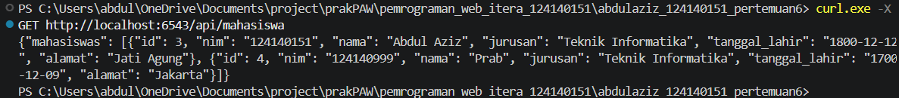

#### Gambar 2 - Mahasiswa: Read One
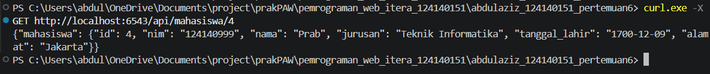

#### Gambar 3 - Mahasiswa: Create
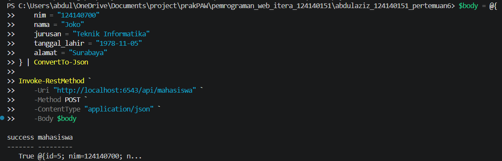

#### Gambar 4 - Mahasiswa: Validasi Gagal (400 Bad Request)
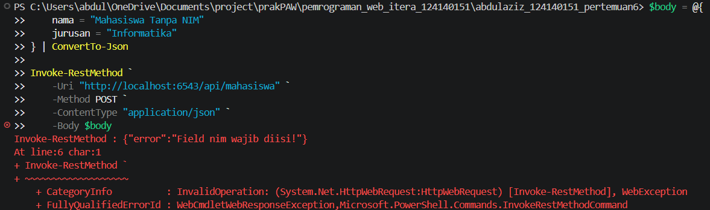

#### Gambar 5 - Mahasiswa: Update
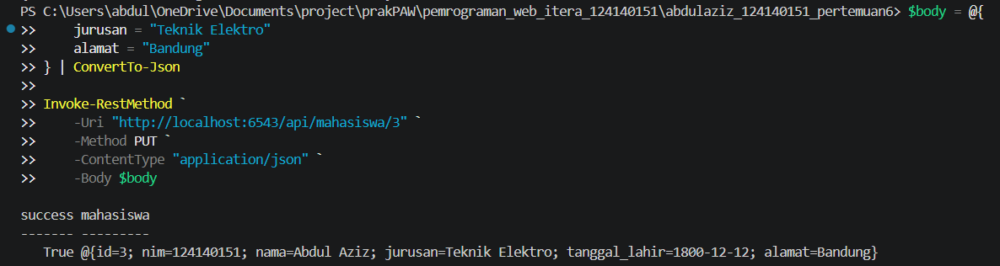

#### Gambar 6 - Mahasiswa: Delete
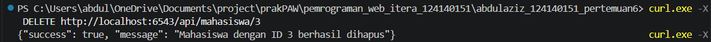

---

### 2. Pengujian Matakuliah (Tugas Praktikum)

| No | Nama File | Keterangan |
|---|---|---|
| 1 | `matakuliah_01_read_all.png` | GET semua mata kuliah (200 OK) |
| 2 | `matakuliah_02_read_one.png` | GET detail mata kuliah (200 OK) |
| 3 | `matakuliah_03_create.png` | POST mata kuliah baru (200 OK) |
| 4 | `matakuliah_04_create_tanpa_kode.png` | POST tanpa `kode_mk` (400 Bad Request) |
| 5 | `matakuliah_05_update.png` | PUT memperbarui data mata kuliah (200 OK) |
| 6 | `matakuliah_06_delete.png` | DELETE mata kuliah (200 OK) |

#### Gambar 7 - Matakuliah: Read All
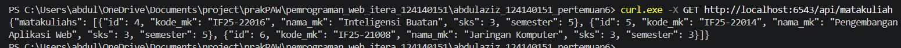

#### Gambar 8 - Matakuliah: Read One
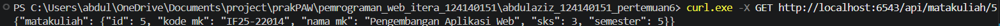

#### Gambar 9 - Matakuliah: Create
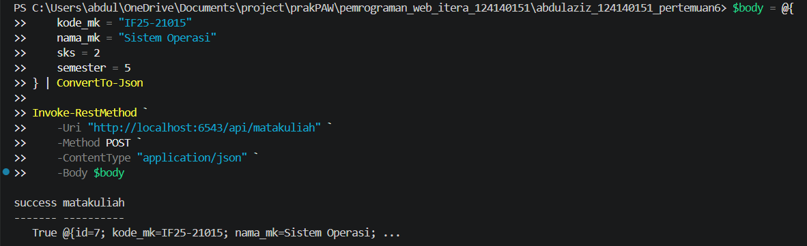

#### Gambar 10 - Matakuliah: Validasi Tanpa `kode_mk` (400 Bad Request)
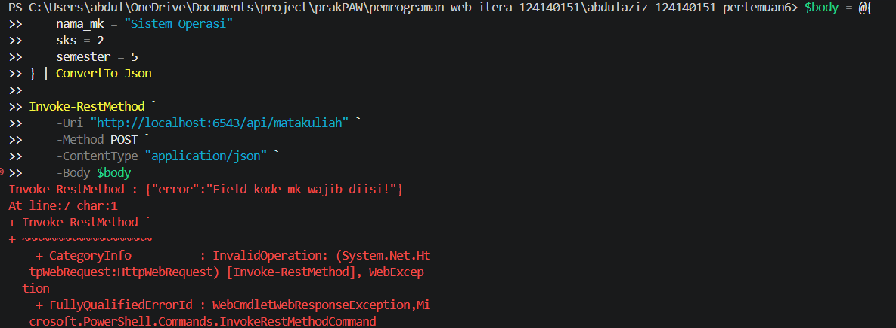

#### Gambar 11 - Matakuliah: Update
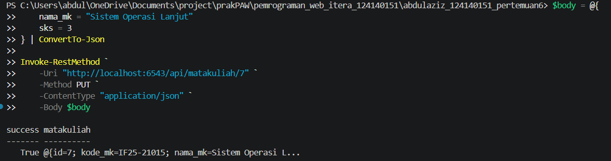

#### Gambar 12 - Matakuliah: Delete
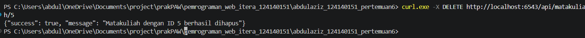
